<a href="https://mederic.me"></a>

<a href="https://github.com/starside-io"></a>

<!-- TODO: point the Fellowship card at its public repo URL -->

<a href="https://github.com/crimson-med/fellowship"></a><a href="https://github.com/starside-io/neurowire"></a><a href="https://github.com/crimson-med/cozy-steamworks"></a>

<a href="https://github.com/crimson-med/openquestformat"></a><a href="https://github.com/starside-io/langdrift"></a><a href="https://github.com/starside-io/ghostwriter"></a>

<a href="https://mederic.me/about"></a>

<a href="https://mederic.me/blog"></a>

<a href="https://mederic.me/blog/scope-beats-autonomy"></a><a href="https://mederic.me/blog/measuring-ai-productivity"></a>

<a href="https://mederic.me/blog/700-engineers-on-adoption"></a><a href="https://mederic.me/blog/oqf-no-engine-owns-your-quests"></a>

<a href="https://mederic.me/blog/rust-native-module-four-targets"></a><a href="https://mederic.me/blog/nwf-format-design"></a>

  
  
  
  

